

  

  

  

  <a href="https://github.com/The-Shreyas-M/Oculius">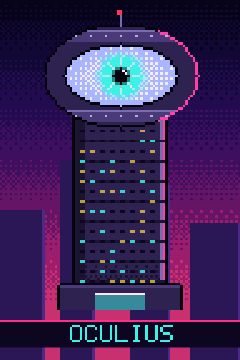</a>
  <a href="https://github.com/The-Shreyas-M/65w-super-fast-charger-type-c">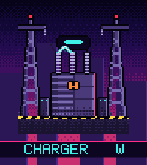</a>
  <a href="https://github.com/The-Shreyas-M/chocobao">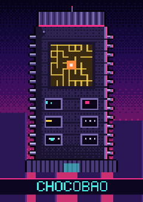</a>
  <a href="https://github.com/The-Shreyas-M/ESP32-Synth">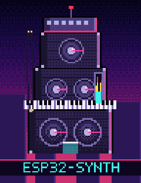</a>

  <a href="https://github.com/The-Shreyas-M/NEURA">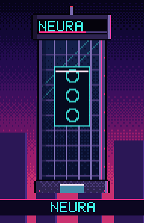</a>
  <a href="https://github.com/The-Shreyas-M/ai-video-editor">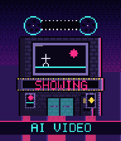</a>
  <a href="https://github.com/The-Shreyas-M/Axiom">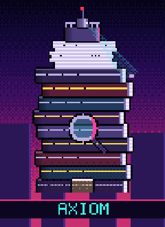</a>

  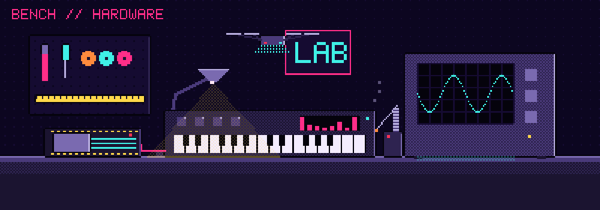

  

  <a href="https://iamshreyas.pages.dev">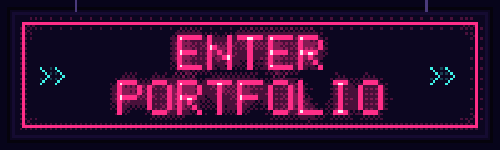</a>
  <a href="https://www.youtube.com/@The-Shreyas-M/"></a>

